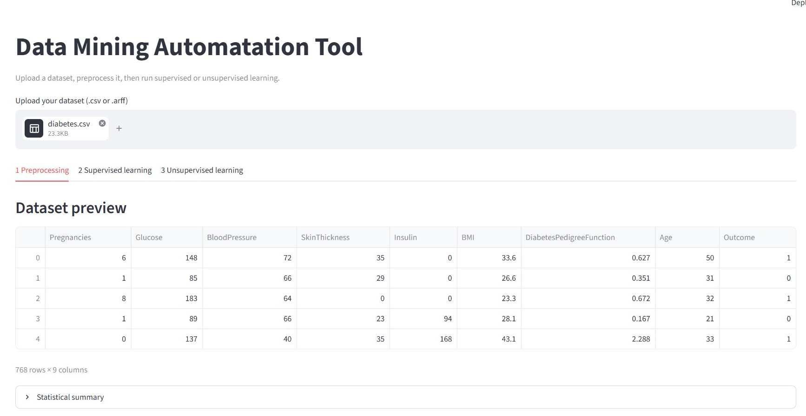
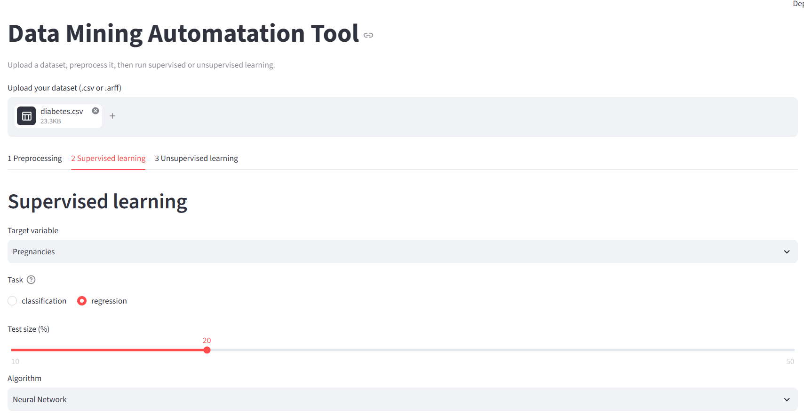
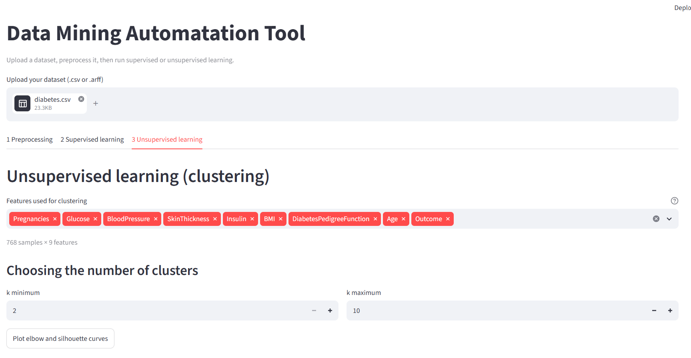

# Data Mining App

An interactive [Streamlit](https://streamlit.io) application that automates the whole
data-mining workflow on a tabular dataset: **preprocessing → supervised learning →
unsupervised learning**, with metrics and plots, without writing any code.




## Features

**Data loading**
- CSV and ARFF files (nominal values decoded, `?` read as missing)

**Preprocessing**
- Exclusion of columns (identifiers, labels…) and duplicate removal
- Missing values, chosen per column: drop rows, drop the column, mean, mode
- One-hot encoding of categorical columns
- Min-Max and Z-Score normalization on selected columns

**Supervised learning** (classification or regression, auto-detected and overridable)
- Classification: KNN, Naive Bayes, decision trees (CART / entropy), neural network (MLP)
- Regression: linear regression, neural network (MLP)
- Metrics: accuracy, precision, recall, F1, AUC (classification); MSE, RMSE, MAE, R² (regression)
- Plots: confusion matrix, ROC curve (binary and one-vs-rest), decision tree, loss curve,
  predictions vs actual, residuals

**Unsupervised learning**
- KMeans, KMedoids, AGNES (agglomerative, 4 linkages, dendrogram), DIANA (divisive), DBSCAN
- Elbow and silhouette curves to choose *k*
- Intra/inter-cluster inertia and silhouette, computed the same way for every algorithm
- 2-D PCA view of the clusters, comparison of all runs, CSV export with cluster labels

## Quick start

```bash
git clone https://github.com/<your-username>/data-mining-app.git
cd data-mining-app
python -m venv .venv && source .venv/bin/activate   # Windows: .venv\Scripts\activate
pip install -r requirements.txt
streamlit run app.py
```

Sample datasets to try are in [`data/sample/`](data/sample): `iris.csv`, `iris.arff`
(classification / clustering) and `diabetes.csv` (regression, target column `target`).
Both come from the datasets bundled with scikit-learn.

## Project structure

```
data-mining-app/
├── app.py                  # entry point: layout and tabs only
├── src/                    # core logic, no Streamlit code (easy to test and reuse)
│   ├── data_loader.py      # CSV / ARFF loading
│   ├── preprocessing.py    # cleaning, imputation, encoding, scaling
│   ├── supervised.py       # task detection, split, models, evaluation
│   ├── unsupervised.py     # clustering algorithms and metrics
│   └── plots.py            # matplotlib figures
├── ui/                     # Streamlit widgets, one module per tab
├── tests/                  # pytest suite
├── data/sample/            # example datasets
└── requirements.txt
```

## Tests

```bash
pip install -r requirements-dev.txt
pytest
```
